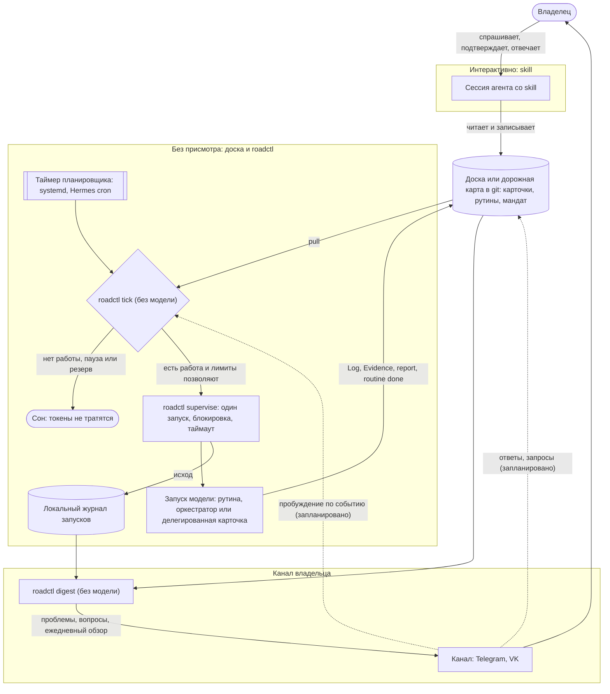

# Road-map Journal

[English](README.md) · **Русский**

Переносимый [Agent Skill](https://agentskills.io/), который помогает вести дорожную карту проекта, ближайшие шаги и историю решений между сессиями ИИ-агентов. Он следует плану и соглашениям вашего проекта, а не заменяет их.

**Установка:** `npx skills add Lujker/road-map-journal --skill road-map-journal`

**Попробуйте:** спросите агента «Что дальше по плану?» или “What is next on the roadmap?”

> Ранняя разработка: проверены установка и несколько коротких сценариев. Обнаружение каждым агентом и поведение на долгих проектах проверены не полностью; просматривайте изменения агента перед принятием. См. [ROADMAP.md](ROADMAP.md). Это перевод [README.md](README.md); при расхождении ориентируйтесь на английский оригинал.

## Что он делает

- Находит существующую дорожную карту и следует соглашениям проекта, а не заменяет их.
- Держит текущее состояние и следующие шаги краткими; решения и свидетельства при необходимости записывает отдельно.
- Возобновляет работу по реальному состоянию проекта и различает реализованное, проверенное и принятое.
- Поддерживает начало, принятие (adopt), возобновление и обновление плана, а также вопросы о состоянии только на чтение.
- Использует язык, уже принятый в проекте, а для нового плана договаривается с пользователем.

Skill — это набор инструкций, а не трекер задач и не гарантия того, что агент выполнит каждое правило. Результат зависит от модели, среды запуска, прав и инструкций проекта. Он не добавляет сервисов, хуков, заданий по расписанию и исполняемых помощников. Необязательный скрипт обслуживания лежит в `scripts/` вне папки skill и вместе с ним не устанавливается.

## Как это работает

Верх схемы — это сам skill: сессия агента читает и записывает план. Всё ниже — необязательные доска и помощник `roadctl` для работы без присмотра, построенные по циклу always-on агента: сон, пробуждение по таймеру, решение без модели, один ограниченный запуск, запись результата, отчёт владельцу. Пунктир — запланированное, ещё не реализованное.



Устройство работы без присмотра сверено и доработано по статье Anthropic [Building always-on agents](https://claude.com/resources/articles/building-always-on-agents) (13.11.2026); в [docs/always-on-model.ru.md](docs/always-on-model.ru.md) — какие её примитивы у нас чему соответствуют и что мы сознательно делаем иначе.

## Использование

Попросите агента, например:

- «Прими существующий план проекта и не меняй нашу структуру.»
- «Что дальше по дорожной карте?»
- «Продолжай разработку по согласованному пункту, но не начинай другой.»
- «Запиши решение и обнови, что осталось.»
- «Сверь статус этого пункта с кодом и имеющимися свидетельствами.»
- “What is next on the roadmap?”
- “Continue the agreed item, but don't start another one.”

При начале нового плана skill обсуждает желаемый способ работы и задаёт вопросы по тому, что нельзя вывести самому. Составление, ревью и улучшение плана, трека или правил автономной работы идут интервью в духе «grilling», которое заранее выявляет риски и противоречия: skill использует `grilling` из [mattpocock/skills](https://github.com/mattpocock/skills) (команды владельца `/grill-me` или `/grill-with-docs` вместе с `domain-modeling`, если план надо сверить с кодом), предлагает установить их, если их нет (`npx skills@latest add mattpocock/skills -g --skill grilling --skill grill-me`), а при отказе проводит такой же опрос сам. Без разрешения необязательный skill не устанавливается. Обычный вопрос только на чтение не должен запускать опрос или создавать файлы.

Синтетические примеры на русском и английском с ожидаемым поведением — в [examples/](examples/README.md). Это предлагаемые проверки, а не результаты прогонов.

## Установка

```sh
npx skills add Lujker/road-map-journal --skill road-map-journal
```

Перед установкой просмотрите исходники и выберите нужного агента и область установки. Неинтерактивная установка в область проекта с `--agent claude-code --yes --copy` проверена в WSL. Отдельно проверены обнаружение skill и явный вызов в пользовательской области на выбранных установках Claude Code и Codex; это не доказывает автоматическую активацию и совместимость на любой среде.

Для ручной установки скопируйте **всю** папку `skills/road-map-journal/` вместе с `references/` в каталог skill, указанный в документации вашего агента. Одно лишь наличие файлов не доказывает, что агент их обнаружит и будет им следовать.

Необязательный формат доски с карточками и помощник для крупных проектов описаны в [docs/board-spec.md](docs/board-spec.md), [docs/roadctl.md](docs/roadctl.md) и [docs/pointer-templates.md](docs/pointer-templates.md) (на английском); для работы со skill они не нужны.

**Обновление** — ручное действие на каждой среде; переустановка может перезаписать локальные правки. Подробности и необязательный скрипт обновления — в [docs/updating.md](docs/updating.md) (на английском).

## Состав

```text
skills/road-map-journal/
├── SKILL.md
└── references/
    ├── board.md
    ├── long-running.md
    ├── multi-repo-sync.md
    ├── scenarios.md
    └── templates.md
```

Исходный skill не привязан к модели. У конкретного агента могут быть свои правила обнаружения skill и свои инструменты. Инструкции проекта и пользователя важнее настроек skill по умолчанию.

## Развитие и ограничения

План — в [ROADMAP.md](ROADMAP.md), релизы — в [CHANGELOG.md](CHANGELOG.md), предлагаемые поведенческие проверки — в [evals/scenarios.md](evals/scenarios.md). Эти сценарии не являются результатами. Превосходство над альтернативами и совместимость между агентами не заявляются без сопоставимых прогонов.

Происхождение материалов репозитория описано в [PROVENANCE.md](PROVENANCE.md). Замечания и вклад приветствуются. Не включайте в отчёты закрытые планы проектов, токены, данные клиентов и стенограммы сессий. Публичный черновик распространяется по [лицензии MIT](LICENSE). Не копируйте существенный сторонний материал без совместимого разрешения и указания авторства.
